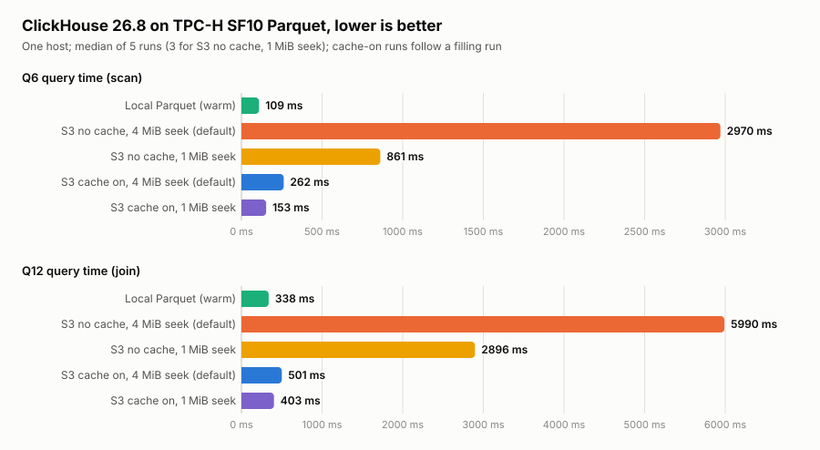

# TPC-H on ClickHouse over Parquet (Docker)

Steps to query TPC-H data stored as Parquet files directly from ClickHouse 26.8 (LTS) in Docker,
with no load step: views over the `file()` table function read the files that `tpchgen`
generates. Status: all steps below were run on SF10 (all eight tables, Q6 and Q12). The native
MergeTree run is in `../clickhouse/`.

Assumes Docker is installed. Run the commands from the repository root.

## 1. Stop the other engines

Run one engine at a time so they do not compete for CPU and cache.

```bash
docker stop pg18 whpg mdb ch 2>/dev/null || true      # whichever of the other engines are running
```

## 2. Generate Parquet

```bash
sudo mkdir -p /data/tpch-parquet && sudo chown ubuntu:ubuntu /data/tpch-parquet
docker run --rm -v /data/tpch-parquet:/out ghcr.io/jsc0218/tpchgen:latest parquet -s 10 --output-dir /out
ls -lh /data/tpch-parquet      # one <table>.parquet per table, 3.7 GB in total
```

## 3. Start ClickHouse with the files mounted

`file()` only reads under `user_files`, so mount the Parquet directory there.

```bash
sudo mkdir -p /data/chpq && sudo chown ubuntu:ubuntu /data/chpq
docker pull clickhouse/clickhouse-server:26.8.30.8

docker run -d --name chpq \
  --network host \
  --ulimit nofile=262144:262144 \
  -v /data/chpq:/var/lib/clickhouse \
  -v /data/tpch-parquet:/var/lib/clickhouse/user_files/tpch \
  clickhouse/clickhouse-server:26.8.30.8

docker exec -it chpq clickhouse-client -q "SELECT version()"    # expect 26.8.30.8
```

Do not mount the directory read-only (`:ro`): the image entrypoint runs `chown` on
`user_files` and the container exits with "Read-only file system".

## 4. Create the views

```bash
docker exec -i chpq clickhouse-client --multiquery < clickhouse-parquet/schema.sql

docker exec -it chpq clickhouse-client -q "SELECT count() FROM lineitem"   # SF10: 59986052
```

## 5. Run Q6

```bash
docker exec -i chpq clickhouse-client --time < clickhouse-parquet/queries/q6.sql
```

Expect `1230113636.0101`, then the elapsed time in seconds (0.109 = 109 ms).

Median over 5 runs:

```bash
for i in 1 2 3 4 5; do docker exec -i chpq clickhouse-client --time < clickhouse-parquet/queries/q6.sql; done
```

## 6. Run Q12

```bash
docker exec -i chpq clickhouse-client --time < clickhouse-parquet/queries/q12.sql
```

At SF10 the result is MAIL 62071 93045 and SHIP 62426 93261. The query files are the same as in
`../clickhouse/queries/`, so the decimal pitfall in `../clickhouse/README.md` applies: write
decimal bounds as literals and check every result before trusting its timing.

## Parquet in S3 (object storage)

The same Parquet files can be queried from S3. The bucket must be in the same region as the EC2
host (here `us-east-1`), and the instance role needs read access.

```bash
aws s3 sync /data/tpch-parquet s3://<bucket>/tpch-parquet/sf10/      # 3.6 GiB, 8 objects, about 7 s

sudo mkdir -p /data/chs3 && sudo chown ubuntu:ubuntu /data/chs3
docker run -d --name chs3 --network host --ulimit nofile=262144:262144 \
  -v /data/chs3:/var/lib/clickhouse clickhouse/clickhouse-server:26.8.30.8
```

ClickHouse 26.8 refuses to use the server's own credentials (instance profile) from `s3()` in
user queries. To use the instance role instead of static keys, enable the setting for the default
profile:

```bash
docker exec chs3 bash -c 'cat > /etc/clickhouse-server/users.d/s3_creds.xml <<EOF
<clickhouse><profiles><default><s3_allow_server_credentials_in_user_queries>1</s3_allow_server_credentials_in_user_queries></default></profiles></clickhouse>
EOF'

sed 's/<bucket>/YOUR-BUCKET/' clickhouse-parquet/schema_s3.sql \
  | docker exec -i chs3 clickhouse-client --multiquery
```

Run Q6 and Q12 as in steps 5 and 6, with `chs3` in place of `chpq`. With no filesystem cache
configured (the default), every run reads from S3 again, which is the object-storage cost.

Optional, cache on: define a 10 GiB ClickHouse filesystem cache, restart, and add two client
settings. The first run fills the cache.

```bash
docker exec chs3 bash -c 'cat > /etc/clickhouse-server/config.d/fscache.xml <<EOF
<clickhouse><filesystem_caches><s3cache><path>/var/lib/clickhouse/s3cache/</path><max_size>10Gi</max_size></s3cache></filesystem_caches></clickhouse>
EOF'
docker restart chs3
docker exec -i chs3 clickhouse-client --enable_filesystem_cache=1 --filesystem_cache_name=s3cache \
  --time < clickhouse-parquet/queries/q6.sql
```

### Tuning: `remote_read_min_bytes_for_seek`

By default (4 MiB), when the Parquet reader needs two column chunks that are less than 4 MiB apart,
ClickHouse reads straight through the gap instead of issuing a second request. Q6 needs 4 of
`lineitem`'s 16 columns, so it reads 1.93 GiB from S3 where the query needs about 0.6 GiB (a local
read of the same query touches 559 MiB). Q12 reads 2.64 GiB against 556 MiB. Lowering the setting
to 1 MiB removes most of that extra read; lowering it further only adds requests. Add it to the
client command (or put it in the default profile):

```bash
docker exec -i chs3 clickhouse-client --remote_read_min_bytes_for_seek=1048576 --time < clickhouse-parquet/queries/q6.sql
```

Q6, no cache, median of 3 (S3 data read, requests): 4 MiB 4.36 s (1.93 GiB, 134); 1 MiB 0.86 s
(613 MiB, 527); 256 KiB 1.85 s (613 MiB, 918); 8 KiB 19.6 s (561 MiB, 8964); 0 34.0 s (559 MiB,
17818). The cache segment size (`max_file_segment_size`, `boundary_alignment`) made no
difference: 4 MiB and 1 MiB segments gave the same bytes read and timings as the default 32 MiB.
With the cache on, the filling run still reads up to 1.6 GiB from S3; only later runs read the
lower amount. Check every answer after changing the setting (they matched here).

## Observed so far (not a benchmark)



Drawn from [`results.csv`](results.csv) by `python3 clickhouse-parquet/make_chart.py` (standard library
only). The chart has one linear axis per panel, so bar lengths compare within a panel but not
between panels.

| | Q6 | Q12 |
|---|---|---|
| Local Parquet (warm page cache), median of 5 | 109 ms | 338 ms |
| S3, no cache, default seek setting, median of 5 | 2.97 s | 5.99 s |
| S3, no cache, `remote_read_min_bytes_for_seek` 1 MiB, median of 3 | 0.86 s | 2.90 s |
| S3, filesystem cache on, default seek setting, median of 5 (after a filling run) | 262 ms | 501 ms |
| S3, filesystem cache on, 1 MiB seek setting, median of 5 (after a filling run) | 153 ms | 403 ms |

Parquet files on disk: 3.7 GB (3.6 GiB in S3).

Runs (s): local Q6 0.109 0.106 0.134 0.107 0.110, Q12 0.341 0.333 0.359 0.338 0.334; S3 Q6
3.37 2.98 2.87 2.97 2.94 (first run 5.28), Q12 6.30 6.27 5.99 5.39 5.37 (first run 8.74); S3 with
cache Q6 0.267 0.262 0.266 0.222 0.241 (filling run 8.00), Q12 0.526 0.488 0.516 0.486 0.501
(filling run 8.36); S3 with cache and the 1 MiB seek setting Q6 0.157 0.147 0.151 0.153 0.156
(filling run 2.12), Q12 0.413 0.403 0.424 0.393 0.396 (filling run 1.01). Server defaults except
where a row says otherwise, one session, same-region S3. The local runs are warm, so they
show decode and compute speed with almost no I/O and are not an object-storage figure. The native
MergeTree figures in the root README (Q6 72 ms, Q12 113 ms) come from an earlier session, not
from the same run, so the comparison is indicative only.

## Removing things

```bash
docker rm -f chpq
docker rmi clickhouse/clickhouse-server:26.8.30.8
sudo rm -rf /data/chpq /data/tpch-parquet      # deletes the database files and the Parquet data

# S3 run
docker rm -f chs3 && sudo rm -rf /data/chs3
aws s3 rm s3://<bucket>/tpch-parquet/sf10/ --recursive
```

## Notes

- The views have no keys or indexes; ClickHouse reads and decompresses the Parquet files on every
  query.
- Results are TPC-H-derived, not comparable to official TPC Benchmark Results.
