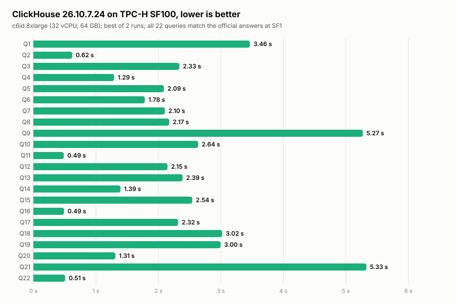

# TPC-H SF100 on ClickHouse 26.10.7.24

One EC2 c6id.8xlarge (32 vCPU, 64 GB, local NVMe on XFS), `clickhouse/clickhouse-server:26.10.7.24` in Docker
(host network, default settings), `kernel.numa_balancing=0`, `/dev/cpu_dma_latency=0` held.
Data from `ghcr.io/jsc0218/tpchgen` (`-s 100`, 88 s), schema from `../clickhouse/schema.sql`
(`lineitem` ordered by `(l_orderkey, l_linenumber)`).

## Results

All 22 queries ran, two runs each, 600 s timeout, no failures. Sum of best-of-2 times 48.7 s,
geometric mean 1.81 s. Raw data: [results-sf100-26.10.7.24.csv](results-sf100-26.10.7.24.csv).



Drawn from the CSV by `python3 make_chart.py` (standard library only).

| | |
|---|---|
| Load (8 tables, 4 files in parallel) | 128 s |
| Database size after merges (active parts) | 23.95 GiB (lineitem 16.03, orders 3.72, partsupp 2.65) |
| Rows | lineitem 600,037,902; orders 150,000,000; partsupp 80,000,000 |

| Query | Run 1 (s) | Run 2 (s) | Rows |
|---|---|---|---|
| Q1 | 3.465 | 3.465 | 4 |
| Q2 | 0.660 | 0.620 | 100 |
| Q3 | 2.383 | 2.335 | 10 |
| Q4 | 1.372 | 1.291 | 5 |
| Q5 | 2.088 | 2.233 | 5 |
| Q6 | 1.783 | 1.786 | 1 |
| Q7 | 2.103 | 2.134 | 4 |
| Q8 | 2.185 | 2.173 | 2 |
| Q9 | 5.272 | 5.275 | 175 |
| Q10 | 2.843 | 2.636 | 20 |
| Q11 | 0.486 | 0.491 | 92698 |
| Q12 | 2.234 | 2.145 | 2 |
| Q13 | 2.496 | 2.387 | 45 |
| Q14 | 1.393 | 1.419 | 1 |
| Q15 | 2.542 | 2.669 | 1 |
| Q16 | 0.490 | 0.505 | 27840 |
| Q17 | 2.316 | 2.324 | 1 |
| Q18 | 3.020 | 3.025 | 100 |
| Q19 | 2.995 | 3.025 | 1 |
| Q20 | 1.316 | 1.311 | 17971 |
| Q21 | 6.025 | 5.329 | 100 |
| Q22 | 0.541 | 0.508 | 7 |

## Correctness

Official answers exist only up to SF1, so `tpch_bench.py validate` runs all 22 queries on SF1 and
compares every row with the official answers (taken from DuckDB's `tpch_answers()`, numbers within
relative 1e-6). All 22 match. SF100 results were not compared with an independent engine.

Two queries differ from the standard text:

- **Q13** has `SET join_use_nulls = 1`. With the default, unmatched `LEFT JOIN` rows get 0 instead of
  NULL and the `c_count = 0` group is missing (41 rows instead of 42 at SF1).
- **Q11**'s threshold is `0.0001 / SF`; the file holds the SF1 value and `tpch_bench.py run --sf 100`
  substitutes `0.000001`. With the SF1 value Q11 returns no rows at SF100.

The other queries are DuckDB's `tpch_queries()` text, unchanged.

## Reproduce

```bash
export CLICKHOUSE_CLIENT="docker exec -i ch clickhouse-client"   # default: clickhouse-client
docker run --rm -v /data/tpch1:/out ghcr.io/jsc0218/tpchgen:latest -s 1 --output-dir /out
docker run --rm -v /data/tpch100:/out ghcr.io/jsc0218/tpchgen:latest -s 100 --output-dir /out
./tpch_bench.py load tpch1 /data/tpch1 && ./tpch_bench.py validate tpch1
./tpch_bench.py load tpch100 /data/tpch100
./tpch_bench.py run tpch100 --sf 100 --runs 2 --timeout 600 --out results.csv
```

Wait for background merges (`select count() from system.merges` is 0) before timing. Python 3, standard library only.
