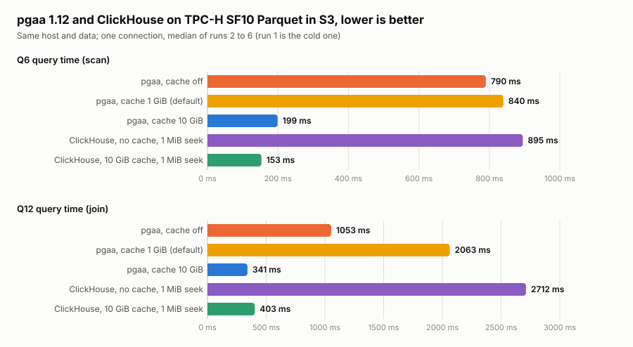

# TPC-H on EDB Postgres Analytics Accelerator (pgaa, Docker)

Steps to run Q6 and Q12 on SF10 through PostgreSQL 18 with the pgaa extension. pgaa sends the
query to Seafowl (an Apache DataFusion engine, run as a Postgres background worker) over Arrow
Flight, and Seafowl reads the Parquet files in place from S3. Nothing is loaded into Postgres.
Same EC2 host and same SF10 Parquet files as `../clickhouse-parquet/`.

## 1. Get the packages

pgaa needs two Debian 12 packages: `postgresql-18-pgaa` (includes the Seafowl binary) and
`edb-pg18-pgfs` (its dependency). They come from EDB's package repository, which needs an EDB
repository token (not part of this repo). Put them in `pgaa/debs/`.

## 2. Data

Use the SF10 Parquet from `../clickhouse-parquet/README.md`, with one folder per table, because
pgaa takes a folder of Parquet files, not a single file path:

```bash
for t in region nation supplier customer part partsupp orders lineitem; do
  aws s3 cp s3://<bucket>/tpch-parquet/sf10/$t.parquet \
            s3://<bucket>/tpch-parquet-dirs/sf10/$t/$t.parquet
done
```

Edit the bucket name in `schema.sql`. The instance needs read access to the bucket (an instance
role works; no keys go into the SQL).

## 3. Build and start

```bash
docker build -t pg18-pgaa pgaa/
docker run -d --name pgaa --network host --shm-size=16g \
  -e POSTGRES_PASSWORD=bench -v /data/pgaa:/var/lib/postgresql \
  pg18-pgaa \
  -c shared_preload_libraries=pgaa \
  -c pgaa.autostart_seafowl=on
```

`pgaa.autostart_seafowl` is off by default; without it every query fails with `Connection
refused` on port 47470. Other Seafowl settings (`pgaa.autostart_seafowl_*`: memory limit,
object-store cache, metadata cache) were left at their defaults.

## 4. Create the tables

```bash
docker exec -i pgaa psql -U postgres < pgaa/schema.sql
```

## 5. Run Q6 and Q12

```bash
docker exec -i pgaa psql -U postgres -c '\timing on' -f - < pgaa/queries/q6.sql
docker exec -i pgaa psql -U postgres -c '\timing on' -f - < pgaa/queries/q12.sql
```

`EXPLAIN` shows a `SeafowlDirectScan` node when pgaa has pushed the query to Seafowl. Expected
answers at SF10: Q6 `1230113636.0101`; Q12 MAIL 62071 93045 and SHIP 62426 93261 (both matched).

## Observed so far (not a benchmark)

S3 in the same region, one session. Each configuration is a fresh container, then the query six
times on one `psql` connection; the table gives run 1 (cold) and the median of runs 2 to 6. The only
setting changed is Seafowl's object-store cache (`pgaa.autostart_seafowl_enable_object_store_cache`,
`pgaa.autostart_seafowl_object_store_cache_capacity_mb`):

| Seafowl object-store cache | Q6 first run | Q6 | Q12 first run | Q12 |
|---|---|---|---|---|
| off | 2273 ms | 790 ms | 1811 ms | 1053 ms |
| on, 1 GiB (default) | 1455 ms | 840 ms | 2000 ms | 2063 ms |
| on, 10 GiB | 1310 ms | 199 ms | 1893 ms | 341 ms |

For comparison, ClickHouse on the same files with `remote_read_min_bytes_for_seek` set to 1 MiB (its
best setting here; the default 4 MiB gives Q6 2980 / 262 ms and Q12 5532 / 501 ms without / with the
10 GiB cache), median of runs 2 to 6 on one connection:

| ClickHouse | Q6 | Q12 |
|---|---|---|
| no cache, 1 MiB seek | 895 ms | 2712 ms |
| 10 GiB cache, 1 MiB seek | 153 ms | 403 ms |



Drawn from [`results.csv`](results.csv) by `python3 pgaa/make_chart.py` (standard library only). The
chart has one linear axis per panel, so bar lengths compare within a panel but not between panels.

The default 1 GiB cache is smaller than `lineitem` (2.4 GiB), so it keeps evicting and is no better
than no cache (Q12 is twice as slow); 10 GiB holds all eight tables. The ClickHouse setup is in
[`../clickhouse-parquet/`](../clickhouse-parquet/README.md).

The numbers are for a connection that is already open. The first query on a new connection costs
about 0.2 s more for Q6 and 0.35 s more for Q12 (with the 10 GiB cache, a fresh connection per
run gave Q6 about 395 ms and Q12 about 690 ms); the cause was not investigated.

## Why the default cache does not help

Seafowl's cache counters (`localhost:9090/metrics`, `seafowl_object_store_cache_*`) show the
working set each query needs cached: about 1.1 GiB for Q6 and about 1.9 GiB for Q12. The default
capacity is 1 GiB, so Q12 scans the same data in the same order every run and each run evicts what
the next one needs: 0 cache hits, 1.9 GiB fetched, written and evicted on every run. Q6 is only
slightly over the capacity, so it gets partial hits (about 0.4 to 0.9 GiB per run) and still
fetches 0.25 to 0.75 GiB each time, which is why it ends up about level with no cache. The cache also fetches about 3.4 times the bytes the query
asks for (1915 MiB against 554 MiB for Q12). At 10 GiB everything fits and later runs are all hits.
The cache has only a capacity, a TTL and a minimum fetch size to set, so size it to the working set.

## Notes

- A local `file://` storage location created tables but every query failed with `No files found
  at file:///...` from Seafowl, in several path layouts. S3 worked.
- The base `postgres` image has no CA certificates, which made S3 fail with a generic
  `error sending request`; the Dockerfile installs them.
- Results are TPC-H-derived, not comparable to official TPC Benchmark Results.
