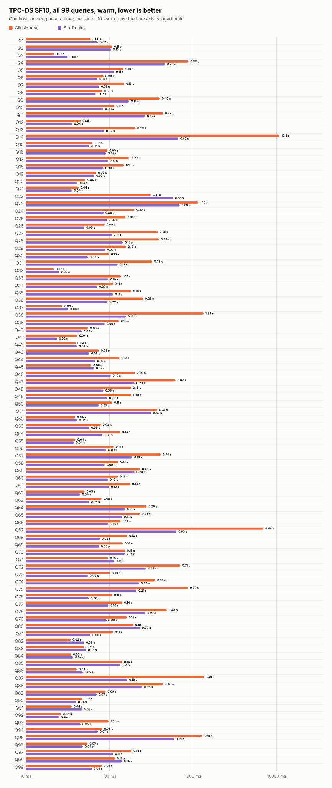

# TPC-DS SF10, all 99 queries: ClickHouse and StarRocks (warm)

All 99 TPC-DS queries on SF10 (a 12.2 GB set of `.dat` files, 28,800,991 `store_sales` rows) in two column
stores: ClickHouse 26.10.7.24 and StarRocks 4.1.8. Same EC2 host as the rest of this repo (Ubuntu, x86_64,
Xeon Platinum 8375C, 32 vCPUs = 16 cores with hyperthreading, 61 GB RAM, instance-store NVMe), one engine
running at a time.

All the data fits in RAM: the databases are 3.76 GiB (ClickHouse) and 3.16 GiB (StarRocks). Only warm
times are reported: the first run of every query is a warm-up and is discarded.

## Results (not a benchmark)

Median of ten warm runs (runs 2 to 6 of two passes), in ms, bold = the faster engine on that query. Both
engines run all 99 queries and return correct answers (see Method).

| | ClickHouse | StarRocks |
|---|---|---|
| **Sum of the 99 medians** | 39.0 s | 12.7 s |
| **Geometric mean** | 145 ms | 93 ms |
| **Faster on** | 16 queries | 83 queries |
| Slowest queries | Q14 10.8 s, Q67 7.0 s, Q87 1.4 s, Q38 1.3 s, Q95 1.3 s | Q23 693 ms, Q14 668 ms, Q4 465 ms |



Drawn from [`results.csv`](results.csv) by `python3 tpcds10/make_chart.py` (standard library only). The time
axis is logarithmic, so bar lengths compare as ratios, not as differences. All the timings are in
[`runs.csv`](runs.csv).

Load time and database size (the database size is the compressed data without logs or WAL; the loads are not
like for like):

| | ClickHouse | StarRocks |
|---|---|---|
| Load (210 files, 8 at a time) | 41.9 s | 20.1 s |
| Statistics (`ANALYZE FULL` on the 24 tables) | none | 33.6 s |
| Database size | 3.76 GiB | 3.16 GiB |

How to read it: StarRocks is faster on 83 of the 99 queries and its 99 medians add up to 12.7 s against
39.0 s for ClickHouse (3.1 times). Two queries make most of that gap: Q14 (ClickHouse 10.8 s, StarRocks
0.67 s, 16 times) and Q67 (7.0 s against 0.63 s, 11 times). Without them the sums are 21.2 s and 11.4 s
(1.9 times). The next largest leads are Q38 (8.5 times), Q87 (8.3), Q75 (4.1), Q27 (3.5) and Q47 (3.1).
ClickHouse's largest lead is Q22 (312 against 577 ms, 1.9 times); its other wins are on queries of 20 to
200 ms (Q1, Q3, Q32, Q37, Q42, Q45, Q52, Q71, Q80, Q82, Q83, Q84, Q86, Q91, Q98). Many queries run in a few
tens of milliseconds, where the spread between the fastest and slowest of the ten warm runs reaches 2.2
times for ClickHouse (Q83) and 2.5 times for StarRocks (Q1); the median query varies by 1.1 and 1.17 times.
Counting a win only where the slowest run of one engine is faster than the fastest run of the other,
StarRocks wins 70 queries, ClickHouse 8, and the runs overlap on 21 (Q1, Q2, Q6, Q8, Q15, Q16, Q19, Q20,
Q21, Q42, Q43, Q45, Q52, Q55, Q70, Q80, Q83, Q84, Q86, Q92 and Q94). Q17 returns no rows with these
parameters on either engine, so its time is that of an empty result.

<details>
<summary>Median warm time of all 99 queries, in ms</summary>

| Query | ClickHouse | StarRocks | Faster |
|---|---|---|---|
| Q1 | **59.8** | 72.7 | ClickHouse |
| Q2 | 108 | **105** | StarRocks |
| Q3 | **21.6** | 31.6 | ClickHouse |
| Q4 | 882 | **465** | StarRocks |
| Q5 | 148 | **114** | StarRocks |
| Q6 | 84.9 | **71.0** | StarRocks |
| Q7 | 150 | **75.5** | StarRocks |
| Q8 | 81.6 | **68.5** | StarRocks |
| Q9 | 402 | **172** | StarRocks |
| Q10 | 115 | **84.2** | StarRocks |
| Q11 | 439 | **267** | StarRocks |
| Q12 | 45.3 | **35.8** | StarRocks |
| Q13 | 204 | **86.4** | StarRocks |
| Q14 | 10845 | **668** | StarRocks |
| Q15 | 61.7 | **56.9** | StarRocks |
| Q16 | 94.9 | **91.3** | StarRocks |
| Q17 | 170 | **95.5** | StarRocks |
| Q18 | 149 | **84.7** | StarRocks |
| Q19 | 69.4 | **66.0** | StarRocks |
| Q20 | 51.8 | **40.7** | StarRocks |
| Q21 | 42.8 | **35.7** | StarRocks |
| Q22 | **312** | 577 | ClickHouse |
| Q23 | 1160 | **693** | StarRocks |
| Q24 | 199 | **85.0** | StarRocks |
| Q25 | 156 | **93.1** | StarRocks |
| Q26 | 87.6 | **50.2** | StarRocks |
| Q27 | 379 | **107** | StarRocks |
| Q28 | 393 | **145** | StarRocks |
| Q29 | 158 | **89.1** | StarRocks |
| Q30 | 99.3 | **55.3** | StarRocks |
| Q31 | 326 | **125** | StarRocks |
| Q32 | **21.6** | 25.0 | ClickHouse |
| Q33 | 137 | **97.1** | StarRocks |
| Q34 | 110 | **71.6** | StarRocks |
| Q35 | 182 | **111** | StarRocks |
| Q36 | 253 | **94.8** | StarRocks |
| Q37 | **27.4** | 32.2 | ClickHouse |
| Q38 | 1337 | **158** | StarRocks |
| Q39 | 130 | **87.7** | StarRocks |
| Q40 | 55.8 | **46.7** | StarRocks |
| Q41 | 41.3 | **23.7** | StarRocks |
| Q42 | **39.4** | 41.0 | ClickHouse |
| Q43 | 75.0 | **57.5** | StarRocks |
| Q44 | 132 | **67.6** | StarRocks |
| Q45 | **60.8** | 65.6 | ClickHouse |
| Q46 | 202 | **104** | StarRocks |
| Q47 | 616 | **199** | StarRocks |
| Q48 | 182 | **84.7** | StarRocks |
| Q49 | 184 | **94.1** | StarRocks |
| Q50 | 108 | **74.6** | StarRocks |
| Q51 | 374 | **317** | StarRocks |
| Q52 | **38.9** | 41.1 | ClickHouse |
| Q53 | 78.8 | **57.4** | StarRocks |
| Q54 | 135 | **81.2** | StarRocks |
| Q55 | 39.1 | **37.7** | StarRocks |
| Q56 | 113 | **91.8** | StarRocks |
| Q57 | 414 | **188** | StarRocks |
| Q58 | 128 | **87.5** | StarRocks |
| Q59 | 233 | **200** | StarRocks |
| Q60 | 126 | **96.0** | StarRocks |
| Q61 | 177 | **99.3** | StarRocks |
| Q62 | 50.5 | **44.7** | StarRocks |
| Q63 | 80.5 | **57.0** | StarRocks |
| Q64 | 279 | **154** | StarRocks |
| Q65 | 231 | **142** | StarRocks |
| Q66 | 136 | **98.0** | StarRocks |
| Q67 | 6983 | **634** | StarRocks |
| Q68 | 164 | **76.8** | StarRocks |
| Q69 | 144 | **75.2** | StarRocks |
| Q70 | 154 | **153** | StarRocks |
| Q71 | **96.6** | 115 | ClickHouse |
| Q72 | 707 | **275** | StarRocks |
| Q73 | 103 | **55.2** | StarRocks |
| Q74 | 354 | **227** | StarRocks |
| Q75 | 873 | **211** | StarRocks |
| Q76 | 108 | **56.6** | StarRocks |
| Q77 | 142 | **98.0** | StarRocks |
| Q78 | 484 | **270** | StarRocks |
| Q79 | 162 | **92.5** | StarRocks |
| Q80 | **193** | 233 | ClickHouse |
| Q81 | 110 | **59.5** | StarRocks |
| Q82 | **34.3** | 50.0 | ClickHouse |
| Q83 | **49.4** | 52.6 | ClickHouse |
| Q84 | **34.9** | 36.9 | ClickHouse |
| Q85 | 142 | **133** | StarRocks |
| Q86 | **40.8** | 48.0 | ClickHouse |
| Q87 | 1359 | **163** | StarRocks |
| Q88 | 435 | **247** | StarRocks |
| Q89 | 90.2 | **70.5** | StarRocks |
| Q90 | 46.9 | **40.0** | StarRocks |
| Q91 | **35.4** | 47.1 | ClickHouse |
| Q92 | 26.4 | **25.3** | StarRocks |
| Q93 | 98.5 | **45.1** | StarRocks |
| Q94 | 82.1 | **72.7** | StarRocks |
| Q95 | 1291 | **590** | StarRocks |
| Q96 | 54.8 | **48.2** | StarRocks |
| Q97 | 184 | **111** | StarRocks |
| Q98 | **117** | 141 | ClickHouse |
| Q99 | 81.2 | **61.5** | StarRocks |

</details>

## Method

- **Data:** `dsdgen` of the TPC-DS tool v2.11.0rc2 (the tree in the Altinity `tpc-ds` repository), scale 10,
  32 parallel children, writing `<table>_<child>_32.dat` files. Both engines hold the same number of rows in all
  24 tables as there are lines in the files. The files hold NULL as an empty field and end every row with `|`. One file (`customer`) is
  Latin-1 (accented country names); it was converted to UTF-8 with `iconv` before loading, so that the
  three systems read the same bytes.
- **Schema:** from the tool's own `tpcds.sql`: decimals stay decimals (`decimal(7,2)`), `NOT NULL`
  columns are not nullable. One name differs: the specification's schema calls a `customer` column
  `c_last_review_date char(10)`, while the queries and the data use `c_last_review_date_sk` (an
  integer key), so both schemas use that. `schema-clickhouse.sql`, `schema-starrocks.sql` and `columns.txt` are written
  by `make_schema.py <tools/tpcds.sql> tpcds10`: ClickHouse tables are
  `MergeTree` ordered by the primary key (the big fact tables by item then ticket or order number, as in
  the Altinity schema, and `inventory` by date, item and warehouse); StarRocks tables are `DUPLICATE KEY`
  on the same columns, the seven fact tables hashed on their item key into 32 buckets in one colocation group
  (`tpcds_item`), `customer`, `customer_address`, `customer_demographics` and `item` in 8 buckets, the other
  dimensions in one, replication 1. The layout and the sort keys are mine; neither engine was tuned.
- **Loading:** `load-clickhouse.sh` (`clickhouse-client`, `FORMAT CSV` with `|`) and `load-starrocks.sh` (Stream
  Load through the FE port). dsdgen's empty field is NULL: ClickHouse reads it as NULL in nullable
  columns, but Stream Load keeps `''` in text columns, so the StarRocks loader reads each nullable text
  column as `tmp_<col>` and stores `nullif(tmp_<col>, '')` (`columns.txt`). StarRocks then ran
  `ANALYZE FULL TABLE` on all 24 tables; ClickHouse has no statistics step.
- **Queries:** the 99 standard queries as DuckDB 2.0.1's `tpcds` extension writes them (`tpcds_queries()`; fixed
  parameters, one statement each, so the four two-part queries 14, 23, 24 and 39 appear in their first
  form only), in `queries/q1.sql` to `q99.sql`, unchanged. They were not regenerated with `dsqgen` for SF10.
  Neither engine runs the text unchanged, so each has a directory with only the queries that had to be
  rewritten; `prepare_queries.sh <engine> <dir>` puts them on top of the standard ones.
  - `queries-clickhouse/` (7 queries): **Q36, Q66** name an inner alias like the column it sums, which
    ClickHouse reads as an aggregate inside an aggregate (renamed the aliases; Q66 also divides by
    `toFloat64(w_warehouse_sq_ft)`, see below). **Q47, Q57** use `avg(sum(x)) OVER (PARTITION BY ..., d_year)`
    next to the aggregate, which the analyzer cannot resolve (aggregate in a subquery first, and `AS`
    names for the columns of `v2`). **Q49** refers to a subquery alias `CATALOG` as `catalog`, and ClickHouse's
    aliases are case sensitive (lower-cased); it also divides by a `Float64`, see below. **Q75** uses
    `COALESCE(x, 0.0)`, which mixes `Decimal` and `Float64` and fails (`0`). **Q58** divides decimals by `3`.
    The reason for the divisions: ClickHouse keeps the scale of the numerator in a `Decimal` division, so
    `x / (y / 3)` truncates to cents at every step (Q58 gave 105.00 where DuckDB gives 105.75; Q66's
    per-row `sales / sq_ft` truncation adds up over rows; Q49's ranks changed), so those three divide by
    a `Float64` (`/3.0`, `toFloat64`, `CAST(... AS Float64)`).
  - `queries-starrocks/` (6 queries): **Q18, Q70, Q86** have `grouping()` in `ORDER BY`, which StarRocks does
    not allow (Q70 and Q86 refer to the `lochierarchy` alias instead, Q18 computes the three grouping bits in an
    inner query). **Q72** has `d1.d_date + 5`, which is numeric in StarRocks (`DATE '2000-01-01' + 5` is
    `20000106.0`), so it uses `date_add(d1.d_date, INTERVAL 5 DAY)`. **Q49** has the same `CATALOG` alias and
    division as ClickHouse (case-sensitive alias; `DOUBLE`). **Q12** has `ORDER BY` without a null order, and
    StarRocks sorts NULLs first where DuckDB and ClickHouse sort them last, which changes which rows
    `LIMIT 100` keeps (the order keys get `NULLS LAST`). Most of the standard queries state
    `NULLS FIRST` themselves, which both engines accept.
- **Settings:** server defaults, with these changes. ClickHouse, on every query (a JSON in the harness
  environment): `join_use_nulls=1` (an outer join yields NULLs, not defaults; without it Altinity's report
  has Q78 returning a wrong empty result), `group_by_use_nulls=1` (`ROLLUP` subtotal rows get NULL instead of
  `''` or 0), `cast_keep_nullable=1` (Q18 casts a NULL to a decimal and fails without it),
  `union_default_mode=DISTINCT` (Q36, Q49 and Q75 write a bare `UNION`), and
  `max_bytes_before_external_group_by` and `max_bytes_before_external_sort` of 5 GB, as in the Altinity
  report (nothing spills at SF10). StarRocks: `ANALYZE FULL TABLE`, nothing else. The host had
  `kernel.numa_balancing=0` and `/dev/cpu_dma_latency=0` held for the runs, as in the SF100 runs.
- **Timing:** `harness/harness.py` runs each query six times back to back on one connection and times each run
  on the client with `perf_counter`, from sending the query to having read every row (`clickhouse-connect`
  over HTTP, `pymysql` for StarRocks, in a container on the engine's network namespace). Two passes per
  engine, one engine running at a time; the warm time is the median of runs 2 to 6 of both passes.
  The two passes differ by 1.11 at most per query for ClickHouse and 1.75 for StarRocks (median 1.02 and 1.06).
- **Answers:** both engines' answers to every query were compared with DuckDB's answer computed from the
  same `.dat` files (`reference.py`, `compare.py`): numbers to the cent for amounts of 10 or more (or
  1e-9 relative), strings exactly, NULL only equal to NULL. All 99 answers match, with these exceptions that
  are not errors: ClickHouse gives three queries whose values are off by one unit of the last printed digit
  (Q2, Q59 and Q78: it truncates a `Decimal` division where DuckDB divides in floating point; 2464 of
  Q2's 2513 rows are affected); StarRocks does so on 2 rows of Q78, and for Q45 and Q50 returns the same
  rows in a different order (the `ORDER BY` has ties). 54 of the 99 queries return 100 rows; 20 return
  one to three rows, and Q17 returns none.

## Reproduce

Start an engine, load it with these scripts, then run the harness in a container on that engine's network (the
engines listen on different ports; run one engine at a time):

```bash
# data: the TPC-DS tool, built as in the Altinity repo (bin/build-tool.sh), 32 children
for i in $(seq 1 32); do ./dsdgen -scale 10 -dir /mnt/nvme/tpcds10 -parallel 32 -child $i -quiet Y & done; wait
iconv -f latin1 -t utf8 /mnt/nvme/tpcds10/customer_1_32.dat > c.u && mv c.u /mnt/nvme/tpcds10/customer_1_32.dat

docker build -t tpcds-harness tpcds10/harness
tpcds10/prepare_queries.sh clickhouse q-ch; tpcds10/prepare_queries.sh starrocks q-sr
mkdir -p out

# ClickHouse
docker run -d --name ch --network host --ulimit nofile=262144:262144 -v /mnt/nvme/ch:/var/lib/clickhouse clickhouse/clickhouse-server:26.10.7.24
docker exec -i ch clickhouse-client --multiquery < tpcds10/schema-clickhouse.sql
DAT_DIR=/mnt/nvme/tpcds10 tpcds10/load-clickhouse.sh
docker run --rm --network container:ch -e RUNS=6 \
  -e CH_SETTINGS='{"join_use_nulls":1,"group_by_use_nulls":1,"cast_keep_nullable":1,"union_default_mode":"DISTINCT","max_bytes_before_external_group_by":5000000000,"max_bytes_before_external_sort":5000000000}' \
  -v $PWD/q-ch:/q:ro -v $PWD/out:/out tpcds-harness clickhouse /q /out/ch_a.json     # a second pass: ch_b.json
docker stop ch

# StarRocks
docker run -d --name starrocks --network host -v /mnt/nvme/sr/fe_meta:/data/deploy/starrocks/fe/meta \
  -v /mnt/nvme/sr/be_storage:/data/deploy/starrocks/be/storage starrocks/allin1-ubuntu:4.1.8
docker exec -i starrocks mysql -h127.0.0.1 -P9030 -uroot < tpcds10/schema-starrocks.sql
DAT_DIR=/mnt/nvme/tpcds10 tpcds10/load-starrocks.sh
for t in $(docker exec starrocks mysql -h127.0.0.1 -P9030 -uroot -N -e "show tables from tpcds"); do
  docker exec starrocks mysql -h127.0.0.1 -P9030 -uroot -e "ANALYZE FULL TABLE tpcds.$t"; done
docker run --rm --network container:starrocks -e RUNS=6 \
  -v $PWD/q-sr:/q:ro -v $PWD/out:/out tpcds-harness starrocks /q /out/sr_a.json      # a second pass: sr_b.json

# reference answers from the same files, the check, then results.csv, runs.csv and the chart
docker run --rm -v /mnt/nvme/tpcds10:/data/tpcds:ro -v $PWD/tpcds10:/w -v $PWD/out:/out -w /w python:3.12-slim \
  sh -c "pip install -q duckdb && python3 reference.py /data/tpcds queries /out/reference.json"
for f in ch_a ch_b sr_a sr_b; do python3 tpcds10/compare.py out/$f.json out/reference.json; done
python3 tpcds10/summarize.py tpcds10 "ClickHouse=out/ch_a.json,out/ch_b.json" "StarRocks=out/sr_a.json,out/sr_b.json"
python3 tpcds10/make_chart.py
```

`RUNS` (default 6), `TIMEOUT` (seconds, default 900) and `ONLY` (a comma-separated list of query numbers)
are environment variables of the harness. `reference.py` reads `.dat` files whose names end in
`_<child>_<children>.dat`.

## Notes

- One host, one node, one session: these are not official TPC-DS results and not a statement about either
  engine on other hardware, other scale factors or tuned configurations. The numbers include client driver
  time, so they are not comparable with `clickhouse-client` timings.
- Results are TPC-DS-derived, not comparable to official TPC Benchmark Results.
- The ClickHouse version differs from the other READMEs of this repo (26.8.30.8 LTS): 26.10.7.24 is the
  version the Altinity TPC-DS report uses.
- The runs were on the evening of 2026-11-20 (Pacific time).
