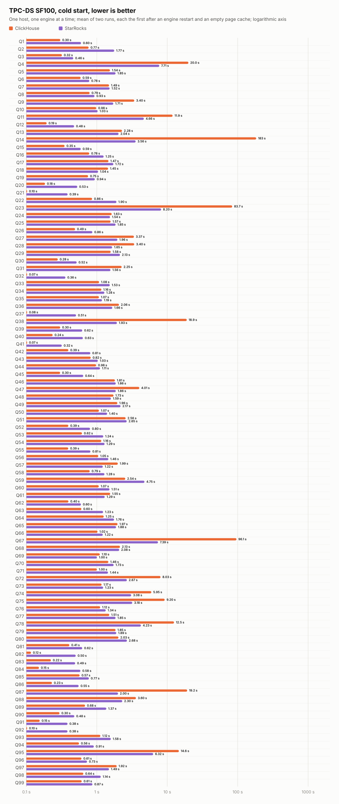
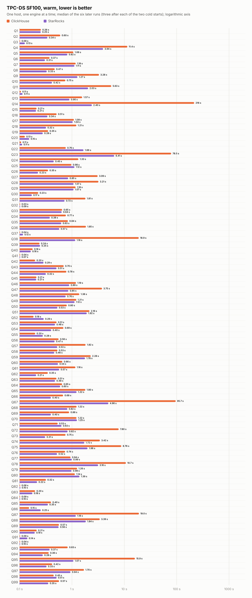

# TPC-DS SF100, all 99 queries: ClickHouse and StarRocks (cold and warm)

All 99 TPC-DS queries on SF100 (a 97 GB set of `.dat` files, 287,997,024 `store_sales` rows) in two column
stores: ClickHouse 26.10.7.24 and StarRocks 4.1.8. Same EC2 host as the rest of this repo (Ubuntu, x86_64,
Xeon Platinum 8375C, 32 vCPUs = 16 cores with hyperthreading, 61 GB RAM, instance-store NVMe), one engine
running at a time. This is the SF100 companion of the [SF10 comparison](../tpcds10/README.md), with the same
schema, queries, settings and checks.

The databases are 33.75 GiB (ClickHouse) and 29.94 GiB (StarRocks) against 61 GB of RAM, so the data fits in
the page cache when warm but not next to the engines' working memory for the largest queries. Both a cold and
a warm time are reported (see Timing).

## Results (not a benchmark)

Both engines run all 99 queries within the 600 s limit and return correct answers (see Method).

| | Cold: ClickHouse | Cold: StarRocks | Warm: ClickHouse | Warm: StarRocks |
|---|---|---|---|---|
| **Sum of the 99 queries** | 580 s | 165 s | 566 s | 79.7 s |
| **Geometric mean** | 1.14 s | 1.28 s | 0.81 s | 0.51 s |
| **Faster on** | 70 queries | 29 queries | 23 queries | 76 queries |
| Slowest queries | Q14 183 s, Q67 96 s, Q23 84 s, Q4 20 s | Q23 8.2 s, Q4 7.7 s, Q67 7.4 s, Q95 6.3 s | Q14 216 s, Q67 96 s, Q23 79 s, Q87 19 s | Q23 6.4 s, Q67 5.0 s, Q4 3.9 s, Q78 3.2 s |





Drawn from [`results.csv`](results.csv) by `python3 tpcds100/make_chart.py` (standard library only). The time
axis is logarithmic, so bar lengths compare as ratios, not as differences. All the timings are in
[`runs.csv`](runs.csv), and how much the data disk read during each cold and warm run is in
[`disk_mib.csv`](disk_mib.csv).

Load time and database size (the database size is the compressed data without logs or WAL; the loads are not
like for like):

| | ClickHouse | StarRocks |
|---|---|---|
| Load (the `.dat` files, 8 at a time) | 188 s | 146 s |
| Statistics (`ANALYZE FULL` on the 24 tables) | none | 207 s |
| Database size | 33.75 GiB | 29.94 GiB |

How to read it: the two engines trade places between cold and warm.

- **Warm**, StarRocks is faster on 76 of the 99 queries and its sum is 79.7 s against 566 s (7.1 times).
  Three queries make most of the gap: Q14 (ClickHouse 216 s, StarRocks 2.4 s), Q67 (96 s against 5.0 s)
  and Q23 (79 s against 6.4 s). Without them the sums are 176 s and 66 s (2.7 times). Counting a win
  only where the difference is more than 10%, StarRocks wins 62 queries and ClickHouse 18.
- **Cold** (the first run after an engine restart and an empty page cache), ClickHouse is faster on 70 of
  the 99 queries, though its sum is still 3.5 times StarRocks' (580 s against 165 s) because of the same
  three queries (Q14 183 s against 3.6 s, Q67 96 s against 7.4 s, Q23 84 s against 8.2 s). The queries
  ClickHouse wins when cold are mostly the short ones, where StarRocks' cold run takes 0.3 to 0.6 s and
  its warm run 0.07 to 0.12 s (Q37, Q32, Q41, Q82, Q84, Q92: ClickHouse about 4 to 7 times faster). Over the
  whole run, the disk read 217 GiB in ClickHouse's 99 cold runs and 191 GiB in StarRocks' (a median of
  1.8 and 1.6 GiB per query).
- ClickHouse's cold and warm times of the heavy queries are nearly the same (Q14 183 s and 216 s, Q67 96 s
  and 96 s): they are CPU-bound or spill (`max_bytes_before_external_*` is 5 GB), not disk-bound. StarRocks'
  heavy queries are 1.3 to 2 times faster warm than cold (Q14, Q67, Q23, Q4).
- The two passes agree: the per-query warm medians differ by a median of 1.02 times (at most 2.43 times,
  for one ClickHouse query) for ClickHouse and 1.03 times (at most 1.14) for StarRocks.

<details>
<summary>Cold and warm time of all 99 queries, in seconds (bold = the faster engine)</summary>

| Query | Cold: ClickHouse | Cold: StarRocks | Warm: ClickHouse | Warm: StarRocks |
|---|---|---|---|---|
| Q1 | **0.30** | 0.60 | 0.26 | **0.25** |
| Q2 | **0.77** | 1.77 | 0.60 | **0.34** |
| Q3 | **0.32** | 0.46 | **0.09** | 0.13 |
| Q4 | 20.0 | **7.71** | 11.4 | **3.94** |
| Q5 | **1.54** | 1.85 | 1.06 | **0.82** |
| Q6 | **0.59** | 0.78 | 0.37 | **0.31** |
| Q7 | **1.49** | 1.52 | 1.18 | **1.11** |
| Q8 | **0.79** | 0.93 | 0.47 | **0.33** |
| Q9 | 3.40 | **1.71** | 3.28 | **1.27** |
| Q10 | **0.98** | 1.03 | 0.75 | **0.42** |
| Q11 | 11.9 | **4.66** | 5.63 | **2.03** |
| Q12 | **0.19** | 0.48 | **0.11** | 0.11 |
| Q13 | 2.28 | **2.04** | 1.57 | **0.90** |
| Q14 | 183.2 | **3.56** | 215.9 | **2.40** |
| Q15 | **0.35** | 0.59 | 0.21 | **0.21** |
| Q16 | **0.78** | 1.25 | 0.51 | **0.34** |
| Q17 | **1.47** | 1.72 | 1.09 | **1.04** |
| Q18 | 1.45 | **1.04** | 1.21 | **0.32** |
| Q19 | **0.75** | 0.94 | 0.35 | **0.28** |
| Q20 | **0.18** | 0.53 | **0.13** | 0.15 |
| Q21 | **0.10** | 0.39 | **0.11** | 0.11 |
| Q22 | **0.86** | 1.90 | **0.76** | 1.66 |
| Q23 | 83.7 | **8.20** | 78.5 | **6.41** |
| Q24 | 1.63 | **1.54** | 1.33 | **0.45** |
| Q25 | **1.57** | 1.85 | **0.98** | 1.12 |
| Q26 | **0.49** | 0.86 | 0.35 | **0.23** |
| Q27 | 3.37 | **1.96** | 3.09 | **0.85** |
| Q28 | 3.40 | **1.65** | 3.21 | **1.07** |
| Q29 | **1.58** | 2.13 | 1.18 | **1.07** |
| Q30 | **0.28** | 0.52 | 0.23 | **0.17** |
| Q31 | 2.25 | **1.56** | 1.81 | **0.72** |
| Q32 | **0.07** | 0.36 | **0.03** | 0.09 |
| Q33 | **1.08** | 1.53 | 0.65 | **0.64** |
| Q34 | **1.16** | 1.28 | 0.77 | **0.38** |
| Q35 | **1.07** | 1.19 | 0.84 | **0.63** |
| Q36 | 2.06 | **1.66** | 1.85 | **0.57** |
| Q37 | **0.08** | 0.51 | **0.04** | 0.12 |
| Q38 | 18.9 | **1.93** | 18.9 | **1.16** |
| Q39 | **0.30** | 0.62 | **0.24** | 0.25 |
| Q40 | **0.24** | 0.63 | 0.18 | **0.16** |
| Q41 | **0.07** | 0.32 | **0.04** | 0.07 |
| Q42 | **0.39** | 0.81 | **0.20** | 0.29 |
| Q43 | **0.82** | 1.03 | 0.70 | **0.51** |
| Q44 | **0.98** | 1.11 | 0.78 | **0.32** |
| Q45 | **0.30** | 0.64 | 0.21 | **0.21** |
| Q46 | **1.81** | 1.86 | 1.19 | **0.89** |
| Q47 | 4.01 | **1.86** | 3.75 | **0.85** |
| Q48 | 1.73 | **1.59** | 1.38 | **0.76** |
| Q49 | **1.96** | 2.17 | 1.21 | **1.12** |
| Q50 | **1.07** | 1.40 | 0.80 | **0.53** |
| Q51 | **2.56** | 2.65 | 2.16 | **1.92** |
| Q52 | **0.39** | 0.80 | **0.18** | 0.29 |
| Q53 | **0.62** | 1.24 | 0.51 | **0.48** |
| Q54 | **1.16** | 1.29 | 0.69 | **0.40** |
| Q55 | **0.39** | 0.81 | **0.20** | 0.28 |
| Q56 | **1.05** | 1.46 | 0.56 | **0.47** |
| Q57 | 1.99 | **1.22** | 1.82 | **0.53** |
| Q58 | **0.79** | 1.28 | 0.53 | **0.46** |
| Q59 | **2.54** | 4.75 | 2.28 | **1.78** |
| Q60 | **1.07** | 1.51 | 0.66 | **0.54** |
| Q61 | 1.55 | **1.29** | 1.16 | **0.57** |
| Q62 | **0.40** | 0.60 | 0.35 | **0.21** |
| Q63 | **0.60** | 1.23 | 0.51 | **0.48** |
| Q64 | **1.25** | 1.76 | 0.65 | **0.60** |
| Q65 | 1.97 | **1.88** | 1.80 | **1.22** |
| Q66 | **1.02** | 1.22 | 0.68 | **0.40** |
| Q67 | 96.1 | **7.39** | 95.7 | **4.96** |
| Q68 | 2.13 | **2.08** | 1.22 | **0.82** |
| Q69 | 1.10 | **1.00** | 0.88 | **0.40** |
| Q70 | **1.46** | 1.73 | **1.22** | 1.25 |
| Q71 | **1.00** | 1.44 | **0.53** | 0.63 |
| Q72 | 8.03 | **2.67** | 7.80 | **0.82** |
| Q73 | **1.17** | 1.23 | 0.75 | **0.31** |
| Q74 | 5.95 | **3.08** | 3.42 | **1.72** |
| Q75 | 9.20 | **3.18** | 8.76 | **1.98** |
| Q76 | **1.12** | 1.34 | 0.74 | **0.52** |
| Q77 | **1.51** | 1.85 | **0.94** | 0.99 |
| Q78 | 12.5 | **4.23** | 10.7 | **3.16** |
| Q79 | **1.85** | 1.89 | 1.26 | **0.98** |
| Q80 | **2.03** | 2.68 | **1.14** | 1.39 |
| Q81 | **0.41** | 0.62 | 0.32 | **0.22** |
| Q82 | **0.12** | 0.50 | **0.06** | 0.10 |
| Q83 | **0.22** | 0.49 | 0.20 | **0.18** |
| Q84 | **0.15** | 0.58 | **0.09** | 0.10 |
| Q85 | **0.57** | 0.77 | 0.40 | **0.35** |
| Q86 | **0.23** | 0.55 | **0.15** | 0.25 |
| Q87 | 19.2 | **2.00** | 19.0 | **1.18** |
| Q88 | 3.60 | **2.30** | 3.39 | **1.84** |
| Q89 | **0.68** | 1.37 | 0.57 | **0.56** |
| Q90 | **0.30** | 0.48 | 0.21 | **0.19** |
| Q91 | **0.15** | 0.38 | **0.09** | 0.14 |
| Q92 | **0.10** | 0.38 | **0.04** | 0.10 |
| Q93 | **1.12** | 1.58 | 0.83 | **0.37** |
| Q94 | **0.56** | 0.91 | 0.36 | **0.28** |
| Q95 | 14.6 | **6.32** | 15.9 | **1.07** |
| Q96 | **0.61** | 0.73 | 0.42 | **0.33** |
| Q97 | 1.92 | **1.49** | 1.70 | **0.94** |
| Q98 | **0.64** | 1.14 | **0.45** | 0.51 |
| Q99 | **0.61** | 0.87 | 0.57 | **0.35** |

</details>

## Method

The data, schema, loading, standard queries, settings, answer check and notes are those of the
[SF10 README](../tpcds10/README.md) (`tpcds100/` reuses its scripts: `prepare_queries.sh` layers
`../tpcds10/queries`, then the SF10 overrides for the engine, then `tpcds100/queries-<engine>`). Scale 100,
32 parallel `dsdgen` children, `customer` converted from Latin-1 to UTF-8. Row counts match between the
engines and the specification (for example `store_sales` 287,997,024, `catalog_sales` 143,997,065,
`web_sales` 72,001,237, `inventory` 399,330,000, `customer` 2,000,000). What differs at SF100:

- **Extra query rewrites** (the SF10 ones still apply):
  - ClickHouse: **Q4** divides decimals by `2`, which truncates to cents at every step (`/2.0`, 3 places).
    **Q17** computes `stddev_samp` of a single row, which is NaN in ClickHouse and NULL in DuckDB and
    StarRocks (`if(isNaN(stddev_samp(x)), NULL, stddev_samp(x))`, 6 places).
  - StarRocks: **Q43, Q45, Q50, Q63** order by columns that can be NULL, and StarRocks sorts NULLs first
    where DuckDB and ClickHouse sort them last, which changes which rows `LIMIT 100` keeps (`NULLS LAST` on
    the keys). **Q50** also returned a wrong result at SF100 (50 rows instead of 100; with `LIMIT 300` it
    returned 150): the TOP-N push-down below the join loses rows. The query carries
    `/*+ SET_VAR(cbo_push_down_topn_limit=0) */`, which turns that optimisation off for it, and then the
    answer is right. Without the hint the query is faster, but wrong. I have not reported it upstream.
- **Timing:** `run_cold.sh` handles each query on its own: `docker restart -t 60` of the engine, `sync`,
  `echo 3 > /proc/sys/vm/drop_caches`, one cold run, then three warm runs on the same connection, with a
  600 s limit per run (a query whose cold run fails or times out skips the warm runs; none did). The harness times
  each run on the client as at SF10. Two passes per engine, one engine running at a time. Cold = the mean of
  the two cold runs; warm = the median of the six warm runs (three after each cold start). Disk reads come
  from `/sys/block/nvme1n1/stat` (sectors read by the data disk during the cold run and the warm runs).
- **Answers:** all four passes were compared with DuckDB's answers computed from the same `.dat` files
  (out-of-core, in a database file on the same NVMe). All 99 answers match, with these exceptions that are not
  errors: ClickHouse gives three queries whose values are off by one unit of the last printed digit (Q2, Q59
  and Q78: it truncates a `Decimal` division where DuckDB divides in floating point), and StarRocks returns
  the same rows as the reference in a different order on Q73 (ties in the `ORDER BY`).
- The runs were on the night of 2026-11-20 to 2026-11-21 (Pacific time), each pass taking between
  35 and 54 minutes. The host had `kernel.numa_balancing=0` and `/dev/cpu_dma_latency=0` held.

## Reproduce

Prepare the SF10 environment first (see the [SF10 README](../tpcds10/README.md)): the harness image, the
loaders and the schemas are the same; only the scale and paths change.

```bash
# data: scale 100, 32 children (as in the SF10 README), then the customer file to UTF-8
for i in $(seq 1 32); do ./dsdgen -scale 100 -dir /mnt/nvme/tpcds100 -parallel 32 -child $i -quiet Y & done; wait
iconv -f latin1 -t utf8 /mnt/nvme/tpcds100/customer_1_32.dat > c.u && mv c.u /mnt/nvme/tpcds100/customer_1_32.dat

docker build -t tpcds-harness tpcds10/harness
tpcds100/prepare_queries.sh clickhouse q-ch; tpcds100/prepare_queries.sh starrocks q-sr

# start an engine and load it as in the SF10 README, with DAT_DIR=/mnt/nvme/tpcds100 (empty data directory first);
# then, one engine at a time, two passes each (disk name of the data disk as the last argument)
tpcds100/run_cold.sh clickhouse q-ch out/ch_1 nvme1n1
tpcds100/run_cold.sh starrocks  q-sr out/sr_1 nvme1n1       # and out/ch_2, out/sr_2

# reference answers from the same files, the check, then results.csv, runs.csv, disk_mib.csv and the charts
DUCKDB_DB=/mnt/nvme/duck/ref100.duckdb DUCKDB_TEMP=/mnt/nvme/duck/tmp DUCKDB_MEMORY=40GB \
  python3 tpcds10/reference.py /mnt/nvme/tpcds100 tpcds10/queries out/reference.json
for f in ch_1 ch_2; do python3 tpcds10/compare.py out/$f/clickhouse.json out/reference.json; done
for f in sr_1 sr_2; do python3 tpcds10/compare.py out/$f/starrocks.json out/reference.json; done
python3 tpcds100/summarize.py tpcds100 "ClickHouse=out/ch_1,out/ch_2" "StarRocks=out/sr_1,out/sr_2"
python3 tpcds100/make_chart.py
```

`WARM` (default 3), `TIMEOUT` (seconds, default 600) and `ONLY` (a comma-separated list of query numbers) are
environment variables of `run_cold.sh`.

## Notes

- One host, one node, one session: these are not official TPC-DS results and not a statement about either
  engine on other hardware, other scale factors or tuned configurations. The numbers include client driver
  time, so they are not comparable with `clickhouse-client` timings.
- Results are TPC-DS-derived, not comparable to official TPC Benchmark Results.
- Cold means an empty OS page cache and a freshly restarted engine, not an empty disk cache on the device.
