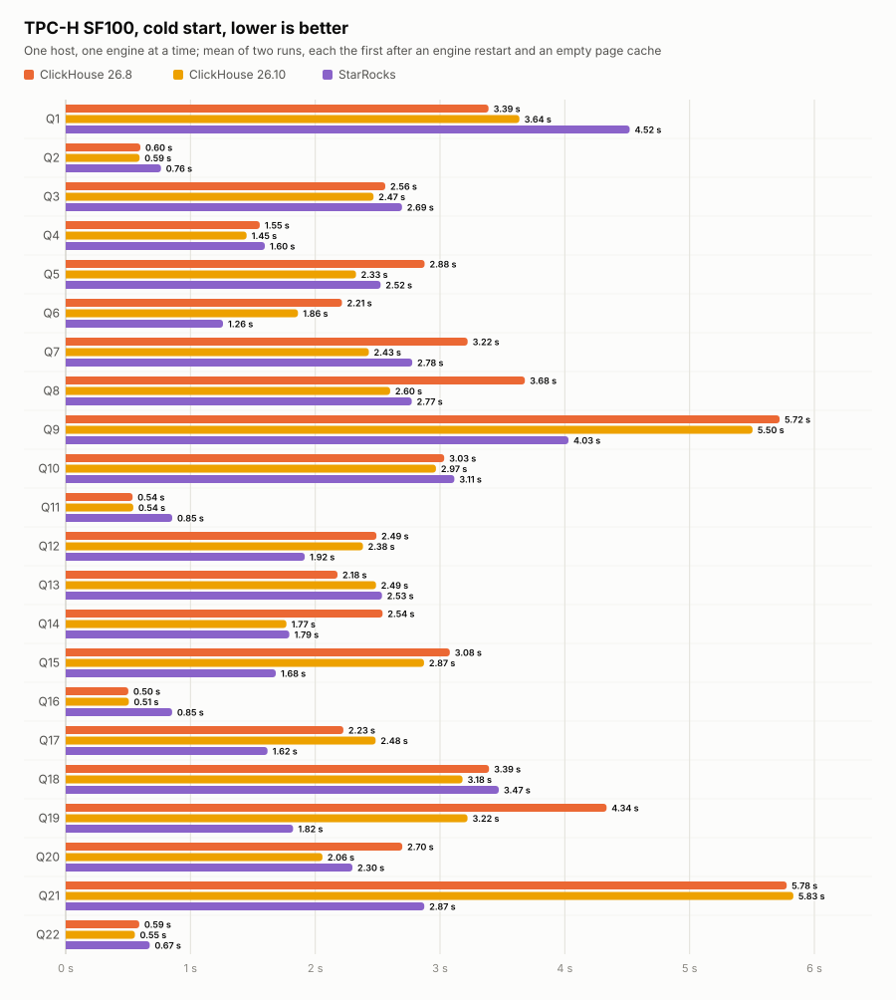
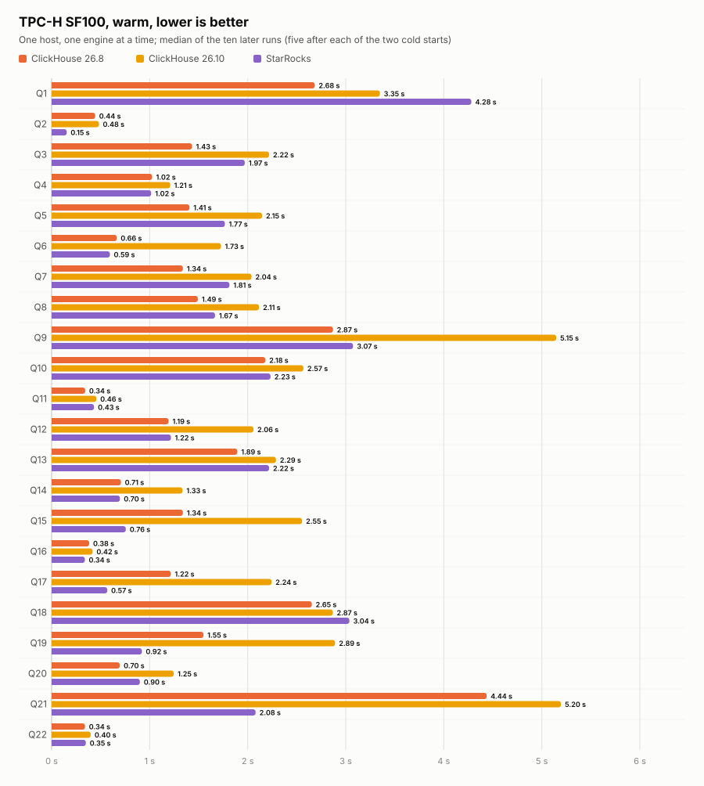

# TPC-H SF100, all 22 queries, data larger than RAM: ClickHouse and StarRocks

All 22 TPC-H queries on SF100 (115 GB, 107 GiB, of `.tbl` files; 600,037,902 `lineitem` rows) in ClickHouse
and StarRocks 4.1.8, on the same EC2 host as the rest of this repo (c6id.8xlarge: Ubuntu, x86_64, 32
vCPUs = 16 cores with hyperthreading, 61 GB RAM, local NVMe), one engine running at a time. ClickHouse is
measured in two versions, 26.8.30.8 (LTS, used in `../tpch22/`) and 26.10.7.24, because they store the same data
in very different sizes (see below). The setup of each engine is in `../clickhouse/` and `../starrocks/`;
the SF10 comparison with all data in RAM is in `../tpch22/`.

SF100 does not fit in RAM as raw files, but the compressed databases (23.7 to 43.5 GiB) mostly would once
they are in the page cache. So each query is timed twice: **cold**, the first run after the engine was
restarted and the OS page cache dropped (the data comes from the NVMe), and **warm**, the median of the
later runs (the data is in the page cache).

## Results (not a benchmark)

Seconds. **Cold**: mean of two passes of the first run of each query after a restart and an empty page cache
(bold = fastest):

| Query | ClickHouse 26.8 | ClickHouse 26.10 | StarRocks | Fastest |
|---|---|---|---|---|
| Q1 | **3.39 s** | 3.64 s | 4.52 s | ClickHouse 26.8 |
| Q2 | 0.60 s | **0.59 s** | 0.76 s | ClickHouse 26.10 |
| Q3 | 2.56 s | **2.47 s** | 2.69 s | ClickHouse 26.10 |
| Q4 | 1.55 s | **1.45 s** | 1.60 s | ClickHouse 26.10 |
| Q5 | 2.88 s | **2.33 s** | 2.52 s | ClickHouse 26.10 |
| Q6 | 2.21 s | 1.86 s | **1.26 s** | StarRocks |
| Q7 | 3.22 s | **2.43 s** | 2.78 s | ClickHouse 26.10 |
| Q8 | 3.68 s | **2.60 s** | 2.77 s | ClickHouse 26.10 |
| Q9 | 5.72 s | 5.50 s | **4.03 s** | StarRocks |
| Q10 | 3.03 s | **2.97 s** | 3.11 s | ClickHouse 26.10 |
| Q11 | **0.54 s** | 0.54 s | 0.85 s | ClickHouse 26.8 |
| Q12 | 2.49 s | 2.38 s | **1.92 s** | StarRocks |
| Q13 | **2.18 s** | 2.49 s | 2.53 s | ClickHouse 26.8 |
| Q14 | 2.54 s | **1.77 s** | 1.79 s | ClickHouse 26.10 |
| Q15 | 3.08 s | 2.87 s | **1.68 s** | StarRocks |
| Q16 | **0.50 s** | 0.51 s | 0.85 s | ClickHouse 26.8 |
| Q17 | 2.23 s | 2.48 s | **1.62 s** | StarRocks |
| Q18 | 3.39 s | **3.18 s** | 3.47 s | ClickHouse 26.10 |
| Q19 | 4.34 s | 3.22 s | **1.82 s** | StarRocks |
| Q20 | 2.70 s | **2.06 s** | 2.30 s | ClickHouse 26.10 |
| Q21 | 5.78 s | 5.83 s | **2.87 s** | StarRocks |
| Q22 | 0.59 s | **0.55 s** | 0.67 s | ClickHouse 26.10 |
| **Sum of the 22** | 59.2 s | 53.7 s | 48.4 s | |
| **Geometric mean** | 2.21 s | 2.01 s | 1.94 s | |
| **Fastest on** | 4 queries | 11 queries | 7 queries | |

Cold runs read 151 GiB (ClickHouse 26.8), 86 GiB (ClickHouse 26.10) and 83 GiB (StarRocks) from the disk in
total over the 22 queries, per the disk's read counter; [`disk_mib.csv`](disk_mib.csv) has it per query.



**Warm**: median of the ten later runs (five after each of the two cold starts):

| Query | ClickHouse 26.8 | ClickHouse 26.10 | StarRocks | Fastest |
|---|---|---|---|---|
| Q1 | **2.68 s** | 3.35 s | 4.28 s | ClickHouse 26.8 |
| Q2 | 0.44 s | 0.48 s | **0.15 s** | StarRocks |
| Q3 | **1.43 s** | 2.22 s | 1.97 s | ClickHouse 26.8 |
| Q4 | 1.02 s | 1.21 s | **1.02 s** | StarRocks |
| Q5 | **1.41 s** | 2.15 s | 1.77 s | ClickHouse 26.8 |
| Q6 | 0.66 s | 1.73 s | **0.59 s** | StarRocks |
| Q7 | **1.34 s** | 2.04 s | 1.81 s | ClickHouse 26.8 |
| Q8 | **1.49 s** | 2.11 s | 1.67 s | ClickHouse 26.8 |
| Q9 | **2.87 s** | 5.15 s | 3.07 s | ClickHouse 26.8 |
| Q10 | **2.18 s** | 2.57 s | 2.23 s | ClickHouse 26.8 |
| Q11 | **0.34 s** | 0.46 s | 0.43 s | ClickHouse 26.8 |
| Q12 | **1.19 s** | 2.06 s | 1.22 s | ClickHouse 26.8 |
| Q13 | **1.89 s** | 2.29 s | 2.22 s | ClickHouse 26.8 |
| Q14 | 0.71 s | 1.33 s | **0.70 s** | StarRocks |
| Q15 | 1.34 s | 2.55 s | **0.76 s** | StarRocks |
| Q16 | 0.38 s | 0.42 s | **0.34 s** | StarRocks |
| Q17 | 1.22 s | 2.24 s | **0.57 s** | StarRocks |
| Q18 | **2.65 s** | 2.87 s | 3.04 s | ClickHouse 26.8 |
| Q19 | 1.55 s | 2.89 s | **0.92 s** | StarRocks |
| Q20 | **0.70 s** | 1.25 s | 0.90 s | ClickHouse 26.8 |
| Q21 | 4.44 s | 5.20 s | **2.08 s** | StarRocks |
| Q22 | **0.34 s** | 0.40 s | 0.35 s | ClickHouse 26.8 |
| **Sum of the 22** | 32.3 s | 47.0 s | 32.1 s | |
| **Geometric mean** | 1.17 s | 1.71 s | 1.09 s | |
| **Fastest on** | 13 queries | 0 queries | 9 queries | |

The warm runs read almost nothing from the disk (at most 66 MiB for any query), so they run from the
page cache.



Drawn from [`results.csv`](results.csv) by `python3 tpch100/make_chart.py` (standard library only). All six timings
of every query and pass are in [`runs.csv`](runs.csv).

Load, database size and rows (all eight tables loaded at the same time in each engine; the loads are not
like for like, and the size is the compressed data without logs):

| | ClickHouse 26.8 | ClickHouse 26.10 | StarRocks |
|---|---|---|---|
| Load | 106 s | 127 s | 444 s |
| Statistics (`ANALYZE FULL`) | none | none | 350 s |
| Database size | 43.5 GiB | 23.7 GiB | 31.1 GiB |
| `lineitem` / `orders` / `partsupp` | 29.9 / 6.7 / 4.5 GiB | 16.0 / 3.7 / 2.7 GiB | not split out |

Rows are the same in all three: `lineitem` 600,037,902, `orders` 150,000,000, `partsupp` 80,000,000.

How to read it:

- **Cold:** StarRocks has the lowest total (48.4 s against 53.7 s for ClickHouse 26.10 and 59.2 s for 26.8, so 1.11 and 1.22
  times). Its lead over 26.10 comes from four queries, Q15, Q17, Q19 and Q21 (8.0 s against 14.4 s; Q19 is 1.8 to 2.4 times
  faster than ClickHouse, Q21 2.0, Q15 1.7 to 1.8); on the other 18 queries it is level with 26.10 (40.4 s against 39.3 s) and
  3.4 s ahead of 26.8 (43.8 s). ClickHouse 26.10 is faster on 15 of the 22 queries, most clearly on the small ones Q16 (1.7 times),
  Q11 (1.6), Q2 (1.3) and Q1 (1.2).
- **Warm:** StarRocks and ClickHouse 26.8 are level in total (32.1 s and 32.3 s) but win different queries: StarRocks
  Q2 (2.9 times), Q17 (2.1), Q21 (2.1) and Q15 (1.8), ClickHouse 26.8 Q1 (1.6), Q3 (1.4), Q7 (1.4) and Q20 (1.3).
  ClickHouse 26.10 is slower when warm (47.0 s), and StarRocks is faster than it on 20 of 22 queries.
- **Cold penalty** (cold total over warm total): 1.51 for StarRocks, 1.83 for ClickHouse 26.8 and 1.14
  for ClickHouse 26.10. ClickHouse 26.10 reads 57 % of the bytes of 26.8 in its cold runs (86 against 151 GiB; database 23.7 against 43.5 GiB), which
  fits it being faster when cold and slower when warm; the cause of the warm slowdown was not measured.
- **Noise:** the two cold passes differ by at most 1.04 times per query for ClickHouse (both versions) and 1.21 for
  StarRocks (median 1.05); the warm medians of the two passes by at most 1.03 and 1.12. Gaps below about 1.2 times
  are not a result.

## Comparison with PR #1 (ClickHouse 26.10.7.24 at SF100)

[PR #1](https://github.com/jsc0218/tpch-docker/pull/1) has SF100 results for the same ClickHouse version (26.10.7.24) on the
same host type (c6id.8xlarge, local NVMe, `numa_balancing=0`, `cpu_dma_latency` held). It times each query twice, back to back,
as the wall time of `clickhouse-client` started with `docker exec`, and its README describes no restart or cache drop between
queries. So its runs resemble my warm runs, not my cold ones. The two sets of numbers agree:

| ClickHouse 26.10.7.24, SF100 | PR #1, run 1 | PR #1, run 2 | PR #1, best of 2 | here, cold | here, warm |
|---|---|---|---|---|---|
| Sum of the 22 | 50.0 s | 49.1 s | 48.7 s | 53.7 s | 47.0 s |
| Geometric mean | 1.86 s | 1.83 s | 1.81 s | 2.01 s | 1.71 s |

- PR #1's best of two is 1.04 times my warm median per query at the median (range 0.97 to 1.29); its total is
  4 % above my warm total. The largest gaps are on the shortest queries (Q2 0.62 against 0.48 s, Q22 0.51 against 0.40 s,
  Q16 0.49 against 0.42 s), which fits a fixed cost of about 0.1 s for starting `docker exec clickhouse-client` per query (not measured).
- PR #1's run 1 is 0.95 times my cold run at the median (7 % lower in total) and almost equal to its own run 2
  (total 50.0 against 49.1 s): its first run is not a cold start.
- Row counts: all 22 queries in PR #1 return the same number of rows as the DuckDB reference here (for example Q11 92,698 and Q20 17,971).
  PR #1 notes that its SF100 answers were not compared with an independent engine; here the answers of this ClickHouse version were (all 22 match).
- Load and size: 128 s and 23.95 GiB in PR #1 (`lineitem` 16.03, `orders` 3.72, `partsupp` 2.65 GiB) against 127 s and 23.71 GiB here (15.98, 3.72, 2.74 GiB).
  PR #1 loads four files at a time; here all eight at once.

## Method

- **Data and storage:** `tpchgen -s 100`, in `/mnt/nvme/tpch100`. The local NVMe (XFS) holds the `.tbl` files and
  both engines' data (ClickHouse `/var/lib/clickhouse`, StarRocks `fe/meta` and `be/storage` mounted from the NVMe), because the
  96 GB root volume is too small. The instance store is ephemeral.
- **Cold start:** for every query, `docker restart` of the engine container, `sync`, `echo 3 > /proc/sys/vm/drop_caches`,
  then the query once (cold) and five more times (warm), on one connection. `run_cold.sh` does this and records the disk's read
  counter (`/sys/block/<disk>/stat`) around the cold run and the five warm runs. The whole pass was done twice, in the same
  order. (`docker restart` sends SIGTERM. For StarRocks the supervisor log shows the BE terminated by SIGKILL on every restart; I did not
  check how ClickHouse stops.)
- **Host settings:** `kernel.numa_balancing=0` and `/dev/cpu_dma_latency` held at 0 for the whole run, as in the SF100
  ClickHouse results elsewhere. This instance does not expose `cpuidle` in sysfs, so the effect on C-states could not be checked.
  The SF10 run in `../tpch22/` did not hold it.
- **Queries and timing:** the same text and harness as `../tpch22/` (the Q11 threshold is `0.0001 / SF`, here `0.0000010000`
  in `queries/q11.sql`; StarRocks Q22 is `../starrocks/queries/q22.sql`). Timings are client-side wall time of execute plus fetch of
  every row, from `../tpch22/harness/`.
- **Answers:** DuckDB computed the answers from the same `.tbl` files out of core (`DUCKDB_DB`, `DUCKDB_MEMORY=40GB` and
  `DUCKDB_TEMP` for `../tpch22/reference.py`; about 2.5 minutes to load and run). All six passes (two per engine) match them: amounts to the
  cent, strings exactly. Q11 has rows with equal values that come out in a different order (124 to 142 of its 92,698 rows).
- **Settings:** server defaults, with `join_use_nulls=1` for ClickHouse (Q13) and `ANALYZE FULL TABLE` for StarRocks after the load,
  the same schemas and bucket counts as at SF10, `query_timeout` 3600 s for StarRocks. ClickHouse waited until no merge was running before timing;
  the first ClickHouse 26.8 pass started 32 minutes after its load, the 26.10 pass a few minutes after its load, once merges had stopped.

## Reproduce

```bash
export DATA=/mnt/nvme/tpch100                      # a disk bigger than 250 GB
docker run --rm -v $DATA:/out ghcr.io/jsc0218/tpchgen:latest -s 100 --output-dir /out

# queries: the 22 standard ones with the SF100 Q11
mkdir -p q100 q100-starrocks && cp tpch22/queries/*.sql q100/ && cp tpch100/queries/q11.sql q100/
cp q100/*.sql q100-starrocks/ && cp starrocks/queries/q22.sql q100-starrocks/
docker build -t tpch-harness tpch22/harness

# ClickHouse: 8 tables at once, then wait until `select count() from system.merges` is 0
docker run -d --name ch --network host --ulimit nofile=262144:262144 -v /mnt/nvme/ch:/var/lib/clickhouse clickhouse/clickhouse-server:26.8.30.8
docker exec -i ch clickhouse-client --multiquery < clickhouse/schema.sql
for t in nation region part supplier partsupp customer orders lineitem; do
  docker exec -i ch clickhouse-client --format_csv_delimiter='|' -q "INSERT INTO $t FORMAT CSV" < $DATA/$t.tbl &
done; wait                                          # run this loop in a shell without other background jobs
tpch100/run_cold.sh clickhouse q100 out/ch268 nvme1n1

# StarRocks: data and metadata on the same disk
docker run -d --name starrocks --network host -v /mnt/nvme/sr/fe_meta:/data/deploy/starrocks/fe/meta \
  -v /mnt/nvme/sr/be_storage:/data/deploy/starrocks/be/storage starrocks/allin1-ubuntu:4.1.8
docker exec -i starrocks mysql -h127.0.0.1 -P9030 -uroot < starrocks/schema.sql
TBL_DIR=$DATA PARALLEL=1 bash starrocks/load.sh      # then ANALYZE FULL TABLE tpch.<t> for the eight tables
tpch100/run_cold.sh starrocks q100-starrocks out/sr nvme1n1

# reference answers and the check; then the CSVs and charts from the output directories of two passes
docker run --rm -e DUCKDB_DB=/duck/ref.duckdb -e DUCKDB_MEMORY=40GB -e DUCKDB_TEMP=/duck/tmp -v $DATA:/data/tpch:ro \
  -v $PWD/tpch22:/w -v $PWD/q100:/q:ro -v $PWD/out:/out -v /mnt/nvme/duck:/duck -w /w python:3.12-slim \
  sh -c "pip install -q duckdb && python3 reference.py /data/tpch /q /out/reference.json"
python3 tpch22/compare.py out/ch268/clickhouse.json out/reference.json
python3 tpch100/summarize.py tpch100 "ClickHouse 26.8=out/ch268,out/ch268_2" "ClickHouse 26.10=out/ch2610,out/ch2610_2" "StarRocks=out/sr,out/sr_2"
python3 tpch100/make_chart.py
```

`run_cold.sh` needs `sudo` (to drop the page cache) and takes the disk name (`nvme1n1` here) as its last argument;
run it twice into two output directories, and a pass takes about 10 minutes per engine.

## Notes

- One host, one node, one day (2026-11-20, Pacific time): not official TPC-H results and not a statement about the engines
  on other hardware, other storage or tuned configurations. The cold numbers depend on this NVMe: one cold query reads 0.1 to 13.4 GiB
  from it.
- Neither engine was tuned. The StarRocks table layout (bucket counts, colocation) and the ClickHouse sort keys are the ones used at SF10.
- ClickHouse 26.10.7.24 stores the same tables in about 55 % of the space of 26.8.30.8 with default settings and the same schema.
  The one column file I inspected in each version starts with an LZ4 block header; I did not find which change between
  the versions causes the difference.
- The StarRocks BE storage directory held 62.6 GiB while the queries ran, twice the 31.1 GiB of tablet data; I did not find out why
  or whether it matters.
- Results are TPC-H-derived, not comparable to official TPC Benchmark Results.
