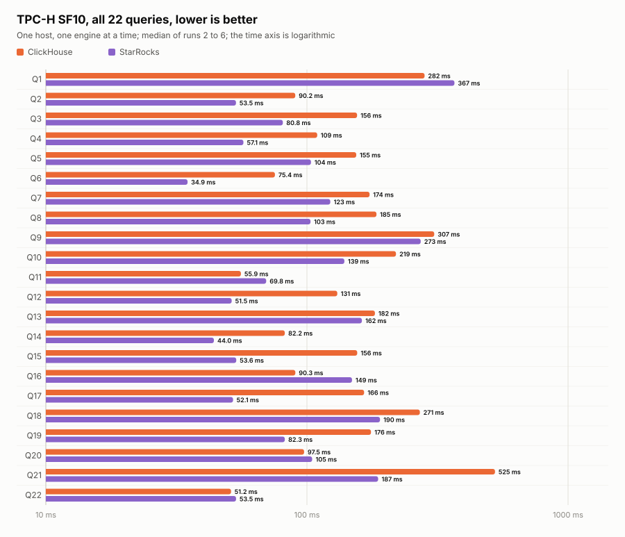

# TPC-H SF10, all 22 queries: ClickHouse and StarRocks

All 22 TPC-H queries on SF10 (about 11 GB of `.tbl` files, 59,986,052 `lineitem` rows) in two column
stores: ClickHouse 26.8.30.8 (LTS) and StarRocks 4.1.8. Same EC2 host as the rest of this repo
(Ubuntu, x86_64, 32 vCPUs = 16 cores with hyperthreading, 61 GB RAM), one engine running at a time.
The steps to set each engine up are in `../clickhouse/` and `../starrocks/`.

All the data fits in RAM: the databases are 4.65 GB (ClickHouse) and 3.17 GB (StarRocks), and the
first runs add up to only about 2 to 5 % more than the later runs.

## Results (not a benchmark)

Median of runs 2 to 6, in ms, of six runs of each query back to back on one connection (bold = the
faster engine on that query):

| Query | ClickHouse | StarRocks | Fastest |
|---|---|---|---|
| Q1 | **282 ms** | 367 ms | ClickHouse |
| Q2 | 90.2 ms | **53.5 ms** | StarRocks |
| Q3 | 156 ms | **80.8 ms** | StarRocks |
| Q4 | 109 ms | **57.1 ms** | StarRocks |
| Q5 | 155 ms | **104 ms** | StarRocks |
| Q6 | 75.4 ms | **34.9 ms** | StarRocks |
| Q7 | 174 ms | **123 ms** | StarRocks |
| Q8 | 185 ms | **103 ms** | StarRocks |
| Q9 | 307 ms | **273 ms** | StarRocks |
| Q10 | 219 ms | **139 ms** | StarRocks |
| Q11 | **55.9 ms** | 69.8 ms | ClickHouse |
| Q12 | 131 ms | **51.5 ms** | StarRocks |
| Q13 | 182 ms | **162 ms** | StarRocks |
| Q14 | 82.2 ms | **44.0 ms** | StarRocks |
| Q15 | 156 ms | **53.6 ms** | StarRocks |
| Q16 | **90.3 ms** | 149 ms | ClickHouse |
| Q17 | 166 ms | **52.1 ms** | StarRocks |
| Q18 | 271 ms | **190 ms** | StarRocks |
| Q19 | 176 ms | **82.3 ms** | StarRocks |
| Q20 | **97.5 ms** | 105 ms | ClickHouse |
| Q21 | 525 ms | **187 ms** | StarRocks |
| Q22 | **51.2 ms** | 53.5 ms | ClickHouse |
| **Sum of the 22 medians** | 3.74 s | 2.54 s | |
| **Geometric mean** | 145 ms | 94 ms | |
| **Fastest on** | 5 queries | 17 queries | |
| Sum of the first runs | 3.83 s | 2.67 s | |



Drawn from [`results.csv`](results.csv) by `python3 tpch22/make_chart.py` (standard library only). The
time axis is logarithmic, so bar lengths compare as ratios, not as differences. All six timings of every
query are in [`runs.csv`](runs.csv).

Load time and database size (the database size is the compressed data without logs or WAL; the loads
are not like for like):

| | ClickHouse | StarRocks |
|---|---|---|
| Load (all tables) | 13.5 s | 56.3 s |
| Statistics (`ANALYZE FULL`) | none | 37.1 s |
| Database size | 4.65 GB | 3.17 GB |

How to read it: StarRocks is faster on 17 of the 22 queries and its 22 medians add up to 2.54 s
against 3.74 s for ClickHouse (1.47 times). Its biggest leads are Q17 (3.2 times), Q15 (2.9), Q21 (2.8,
the slowest query for ClickHouse at 525 ms), Q12 (2.5) and Q6 (2.2). ClickHouse's only clear win is
Q16 (1.65 times, 90 against 149 ms); on Q1 (1.3 times), Q11 (1.25), Q20 (1.07) and Q22 (1.05) it is
ahead by less than the run-to-run noise. The runs of one query vary by up to 1.44 (ClickHouse) and 1.26
(StarRocks) between the fastest and the slowest of runs 2 to 6, so a gap smaller than about 1.4 times
on one query is not a win; that covers seven of the 22 queries (Q1, Q7, Q9, Q11, Q13, Q20 and Q22).
StarRocks loads more slowly and needs a statistics step that ClickHouse does not have.

## Method

- **Queries:** the standard TPC-H text with the validation parameters, taken from DuckDB's `tpch`
  extension (`queries/q1.sql` to `queries/q22.sql`). The text is the same for both engines. The one
  query-text change is Q11, whose threshold fraction is `0.0001 / SF`, so `0.0000100000` at SF10
  (the extension's text has the SF1 value). StarRocks needs one dialect rewrite: Q22 uses
  `substring(c_phone, 1, 2)` instead of `substring(c_phone FROM 1 FOR 2)`
  (`../starrocks/queries/q22.sql`).
- **Timing:** `harness/harness.py` runs each query six times and times each run on the client with
  `perf_counter`, from sending the query to having read every row. It uses `clickhouse-connect`
  (HTTP) and `pymysql` (StarRocks), and runs in a container on the engine's network namespace, so the
  numbers include driver and protocol time. They are therefore not directly comparable to the
  `clickhouse-client` timings in `../clickhouse/README.md` (for example ClickHouse Q6 is 75.4 ms here
  and 94 ms there).
- **Answers:** both engines' answers to every query were compared with DuckDB's answer computed from
  the same `.tbl` files (`reference.py`, `compare.py`). All 44 answers match: numbers to the cent
  for amounts of 10 or more, to 1e-4 for smaller values, strings exactly. Q11 has rows with equal
  values that come out in a different order (2 rows for ClickHouse, 4 for StarRocks), which
  `ORDER BY value DESC` leaves open. DuckDB's own data generator produces different filler text than
  `tpchgen` (addresses and comments), which changes the answers of Q2, Q10, Q13, Q15 and Q20, so the
  reference has to read the `tpchgen` files.
- **Settings:** server defaults, with these changes. ClickHouse: `join_use_nulls=1` on every query, which
  Q13 needs because its left outer join must produce NULLs (without it ClickHouse fills the missing
  side with defaults and counts them). StarRocks: `ANALYZE FULL TABLE` after the load, which gives
  its optimizer statistics, and the session `query_timeout` raised to 3600 s. ClickHouse has no
  statistics step. Tables have no secondary indexes; both engines sort on the primary key.
- **Order of work:** each engine was started on its own, loaded, queried six times per query, and
  stopped before the next one. ClickHouse waited ten minutes after the load for merges to finish.

## Reproduce

Load an engine as described in its folder, then run the harness in a container on that engine's
network (the engines listen on different ports):

```bash
docker build -t tpch-harness tpch22/harness
mkdir -p out
# ClickHouse (container ch) or StarRocks (container starrocks)
docker run --rm --network container:ch -e RUNS=6 -e CH_SETTINGS='{"join_use_nulls":1}' \
  -v $PWD/tpch22/queries:/q:ro -v $PWD/out:/out tpch-harness clickhouse /q /out/clickhouse.json
mkdir -p out/q-starrocks && cp tpch22/queries/*.sql out/q-starrocks && cp starrocks/queries/q22.sql out/q-starrocks/
docker run --rm --network container:starrocks \
  -v $PWD/out/q-starrocks:/q:ro -v $PWD/out:/out tpch-harness starrocks /q /out/starrocks.json

# reference answers from the same files, and the check
docker run --rm -v /data/tpch:/data/tpch:ro -v $PWD/tpch22:/w -v $PWD/out:/out -w /w python:3.12-slim \
  sh -c "pip install -q duckdb && python3 reference.py /data/tpch queries /out/reference.json"
for e in clickhouse starrocks; do python3 tpch22/compare.py out/$e.json out/reference.json; done
```

`RUNS` (default 6), `TIMEOUT` (seconds, default 900) and `ONLY` (a comma-separated list of query
numbers) are environment variables of the harness. The harness also has a `monetdb` driver, which the
results here do not use.

## Notes

- One host, one node, one session: these are not official TPC-H results and not a statement about
  either engine on other hardware, other scale factors or tuned configurations.
- Both engines were left at their defaults apart from the changes above; neither was tuned for these
  queries. The StarRocks table layout (bucket counts, colocation) and the choice of sort keys are mine.
- The run was on 2026-11-20 (Pacific time).
- Results are TPC-H-derived, not comparable to official TPC Benchmark Results.
